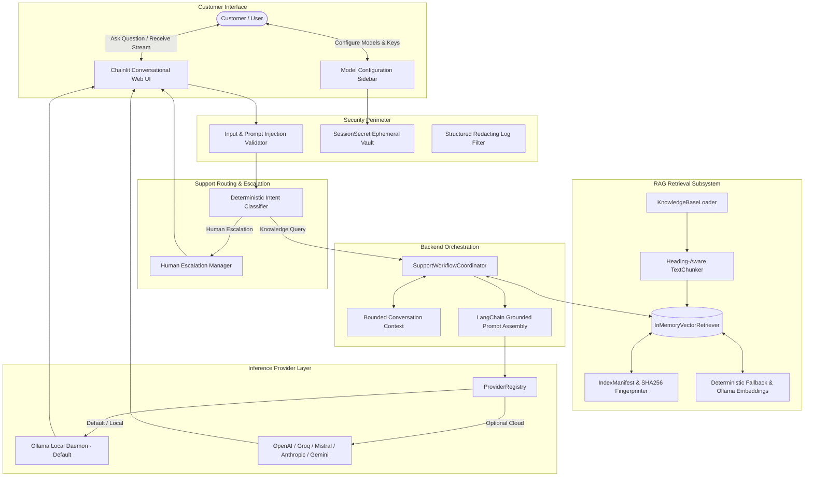

# AI Customer Support Chatbot ⚡
*A Portfolio-Grade Conversational AI Customer Support System with RAG, Local Ollama Inference, Multi-Cloud Adapters, and Deterministic Support Workflows.*

---

## 1. Project Title
**AI Customer Support Chatbot**

---

## 2. Overview
The **AI Customer Support Chatbot** is a production-grade conversational AI application built to answer customer support inquiries accurately by grounding responses in verified support documentation. Rather than relying solely on the static internal weights of a general Large Language Model (which frequently hallucinate or invent policies), this system implements **Retrieval-Augmented Generation (RAG)** to retrieve relevant FAQ documents and ground every generated response.

The application is architected for **zero-cost, 100% private local execution** using [Ollama](https://ollama.com) as the primary engine, while maintaining modular adapters to connect with major cloud providers (OpenAI, Google Gemini, Anthropic Claude, Groq, Mistral AI, and custom OpenAI-compatible gateways) through secure, ephemeral, session-only credentials.

---

## 3. Problem Statement
Customer support organizations face critical challenges when adopting LLM chatbots:
1. **Hallucination Risk:** Standard LLMs invent non-existent refund windows, incorrect shipping dates, and fabricated account balances when prompted about domain-specific policies.
2. **Privacy & Data Egress:** Routing sensitive customer conversations to public cloud APIs violates data sovereignty and privacy requirements for many organizations.
3. **Vendor Lock-in:** Hardcoding applications to a single cloud provider SDK creates fragile monoliths that are costly to migrate.
4. **Credential Exposure:** Poorly designed web interfaces often persist user API keys in browser local storage, cookies, server databases, or unscrubbed logs.
5. **Context Fracturing:** Generic chunking algorithms split questions from answers, causing semantic search to retrieve fragments without actionable context.

This project solves these challenges by combining local open-weight inference, heading-aware Markdown chunking, strict cosine thresholding, session-scoped ephemeral memory vaults, and deterministic support intent routing.

---

## 4. Key Features
- **Real-Time Token Streaming:** Progressive token generation via LangChain `astream` and Chainlit `stream_token` for responsive conversational UX.
- **FAQ Knowledge Grounding:** Vector-similarity search across support documentation with cosine thresholding (`min_score=0.20`) to eliminate irrelevant noise.
- **Heading-Aware Markdown Chunking:** Chunker preserves `##` and `###` question-answer section boundaries to avoid fracturing crucial policy answers.
- **Contextual Query Reformulation:** Follow-up questions with pronouns (*"Can I request it after delivery?"*) automatically inherit prior turn context for accurate retrieval.
- **Index Lifecycle Management:** Dynamic manifest (`IndexManifest`) tracking SHA256 document fingerprints, indexing states (`READY`, `INITIALIZING`, `ERROR`), and safe atomic rebuild rollback.
- **Support Intent Classification & Routing:** Deterministic intent classifier routing queries across 8 categories (`HUMAN_ESCALATION`, `ACCOUNT_ACCESS`, `ORDER_SHIPPING`, `REFUND_CANCELLATION`, `TROUBLESHOOTING`, `FAQ_INFORMATIONAL`, `UNCLEAR_AMBIGUOUS`, `GENERAL_CHAT`).
- **Human Support Escalation Workflow:** Generates structured customer support briefing cards containing recent turns and issue summaries without claiming fake ticket numbers.
- **Zero-Cost Local Inference:** Default execution runs locally with open-weight models via Ollama (`llama3.2:latest`, `mistral`).
- **Session-Only Ephemeral Credentials:** Cloud API keys are held strictly in server-side session memory—never saved to disk, database, chat logs, or Git.
- **Multi-User Session Isolation:** Strict memory boundaries preventing cross-session credential leaks, history bleed, or retrieval cross-talk.
- **Modular Provider Adapters:** 7 distinct providers supported out-of-the-box (`ollama`, `openai`, `google`, `anthropic`, `groq`, `mistral`, `openai_compatible`).
- **Adversarial Prompt-Injection Screening:** Blocks jailbreaks and prompt extraction attempts in both user input and retrieved knowledge context.
- **Defensive Anti-Hallucination Guardrails:** Explicit refusal to fabricate live order statuses or private balances without verified backend APIs.
- **Premium UI & Branding:** Graphite/charcoal theme (`custom.css`), brand badge with fallback, and masked API key inputs.

---

## 5. Technology Stack

| Technology | Category | Role in System |
| :--- | :--- | :--- |
| **Python 3.10 - 3.13** | Backend Core | Asynchronous orchestration, structured logging, and type validation. |
| **Chainlit (2.12+)** | UI Framework | Conversational chat interface, WebSocket streaming, settings drawer, and asset serving. |
| **LangChain Core (0.3+)** | Orchestration | Chat model interfaces, prompt fusion, message abstractions, and async generators. |
| **Ollama** | Local LLM Engine | Zero-cost private inference on host hardware (`llama3.2:latest`). |
| **In-Memory Vector Retriever** | RAG Subsystem | Cosine similarity indexing, score thresholding, and safe atomic rebuilds. |
| **Deterministic Fallback Embeddings** | RAG Embeddings | Regex tokenization, stop-word down-weighting, and hash-based vector generation (zero-dependency). |
| **Pydantic (v2.7+)** | Data Validation | Strict runtime configuration, hyperparameter bounds, and input validation. |
| **pytest & pytest-asyncio** | Quality Assurance | Automated test runner with 62 unit, integration, and scenario tests. |

---

## 6. Architecture Diagram



---

## 7. How the System Works (Request Lifecycle)

```
[1. User Inquiry]
       │
       ▼
[2. Chainlit Ingestion] ────► Real-time UI indicator active
       │
       ▼
[3. Input Validation] ──────► Screen length (< 3000 chars) & prompt-injection patterns
       │
       ▼
[4. Intent Classification] ─► Categorize into 8 support intents
       │
       ├──► If HUMAN_ESCALATION ──► Generate escalation briefing card (Zero fake ticket claims)
       │
       ▼
[5. Context Reformulation] ──► Prepend prior user turn if follow-up contains pronouns / brevity
       │
       ▼
[6. Vector Search (RAG)] ───► Query InMemoryVectorRetriever (filter chunks < min_score 0.20)
       │
       ▼
[7. Prompt Fusion] ─────────► Assemble: System rules + Verified FAQ chunks + Conversation turns + Query
       │
       ▼
[8. Provider Streaming] ────► Token-by-token emission with asyncio.wait_for timeout guard
       │
       ▼
[9. Source Card Pairing] ───► Attach document title, section heading, and factual excerpt
       │
       ▼
[10. State Persistence] ────► Record turn to session-scoped conversation history
```

---

## 8. Why Each Technology Is Used

- **Python:** Industry standard for AI engineering with native async I/O for non-blocking WebSocket streaming.
- **Chainlit:** Provides an intuitive conversational UI without complex frontend JavaScript scaffolding, supporting real-time streaming tokens and custom sidebars.
- **LangChain:** Standardizes message types and chat model APIs, decoupling application logic from vendor SDKs.
- **Ollama:** Enables zero-cost, fully private inference on local workstations without cloud API quotas or external dependencies.
- **Custom In-Memory Vector Store:** Eliminates external vector database management overhead while delivering sub-millisecond retrieval on FAQ collections.
- **Deterministic Hash Embeddings:** Provides instant offline testing and CI/CD verification without requiring a 500MB neural model download.
- **Pydantic v2:** Enforces strict configuration schemas and runtime type-safety.
- **pytest:** Guarantees deterministic regression testing across all support workflows.

---

## 9. Screenshots & Visual Interface

| Interface View | Description | Location |
| :--- | :--- | :--- |
| **Welcome Screen** | Brand badge, local engine reachability status, and interactive FAQ suggestion chips. | Main chat view on startup |
| **Grounded Response & Citations** | Real-time streamed answer paired with verified knowledge source callouts. | Active conversation |
| **Model Configuration Drawer** | Sidebar drawer for selecting providers, setting endpoints, and entering ephemeral keys. | Sidebar (Sliders icon) |
| **Architecture & About Section** | In-app modal rendering system flowcharts, request lifecycles, and privacy guarantees. | Action chip: "About Project" |
| **Human Support Escalation** | Structured briefing card summarizing user inquiry with contact SLAs. | Action chip / prompt |

---

## 10. Prerequisites

- **Operating System:** Windows 10/11, macOS, or Linux.
- **Python:** Python 3.10, 3.11, 3.12, or 3.13.
- **Git:** Standard git version control.
- **Ollama (Optional for local inference):** Installed from [ollama.com](https://ollama.com).

---

## 11. Windows and VS Code Setup

1. Open **VS Code**.
2. Open the project folder: `File > Open Folder...` and select `ai-support-chatbot`.
3. Open a terminal (`Ctrl + ~`) and verify PowerShell is selected.
4. If script execution is restricted on Windows, allow current-user scripts:
   ```powershell
   Set-ExecutionPolicy -ExecutionPolicy RemoteSigned -Scope CurrentUser
   ```

---

## 12. Virtual Environment Setup

Create and activate an isolated virtual environment:

```powershell
# Create virtual environment
python -m venv .venv

# Activate on Windows PowerShell
.venv\Scripts\Activate.ps1
```

---

## 13. Dependency Installation

Install all declared, verified dependencies:

```powershell
# Upgrade pip
.venv\Scripts\python -m pip install --upgrade pip

# Install project dependencies
.venv\Scripts\python -m pip install -r requirements.txt

# Install package in editable development mode
.venv\Scripts\python -m pip install -e .
```

---

## 14. Ollama Setup

1. Download and install Ollama from [ollama.com](https://ollama.com).
2. Start the local Ollama background daemon:
   ```powershell
   ollama serve
   ```
3. Verify reachability by opening `http://localhost:11434` in your browser. It should display:
   ```
   Ollama is running
   ```

---

## 15. Model Installation

Pull the recommended default model:

```powershell
# Default recommended model (compact & fast)
ollama pull llama3.2:latest

# Optional alternative models
ollama pull mistral:latest
ollama pull qwen2.5:latest

# Optional local neural embedding model
ollama pull nomic-embed-text
```

---

## 16. Application Startup

Launch the Chainlit web server:

```powershell
chainlit run app.py -w
```

The application will automatically open in your default browser at:
`http://localhost:8000`

---

## 17. Cloud Provider Configuration (Optional)

If you wish to use an external cloud provider instead of local Ollama:
1. Click the **Sliders icon (⚙️)** in the Chainlit sidebar to open **Model Configuration**.
2. Select your provider:
   - `groq` (Groq ultra-fast LPU inference: `https://api.groq.com/openai/v1`)
   - `openai` (Official OpenAI API: `https://api.openai.com/v1`)
   - `anthropic` (Anthropic Claude 3.5: `https://api.anthropic.com/v1`)
   - `google` (Google Gemini 2.0 / 1.5: `https://generativelanguage.googleapis.com`)
   - `mistral` (Mistral AI European cloud: `https://api.mistral.ai/v1`)
   - `openai_compatible` (Custom gateways: LocalAI, vLLM)
3. Enter your target model identifier or leave blank to use the canonical default:
   - **Groq:** `llama-3.3-70b-versatile` (or `llama-3.1-8b-instant`) — *Note: Do not type `groq`; that is the provider name!*
   - **OpenAI:** `gpt-4o-mini` (or `gpt-4o`)
   - **Anthropic:** `claude-3-5-haiku-latest` (or `claude-3-5-sonnet-latest`)
   - **Google:** `gemini-1.5-flash` (or `gemini-2.0-flash`)
   - **Mistral:** `mistral-small-latest`
4. Enter your API key in the masked **Session API Key** field.
5. Click **Confirm** to apply.
   - The application automatically normalizes the endpoint URL to that provider's official base URL, preventing accidental Ollama (`localhost:11434`) endpoint contamination.
   - A non-destructive provider health check immediately validates your credentials and model availability.
   - You can test connectivity at any time by clicking the **"🔍 Test Provider Connection"** control chip.

---

## 18. API-Key Privacy Explanation

- **Ephemeral Memory Only:** Keys entered in the UI are held exclusively in volatile server-side session memory (`cl.user_session`).
- **Zero Disk Persistence:** Keys are **never** written to `.env`, SQLite databases, flat files, local storage, cookies, or Git.
- **Log Redaction:** All logger handlers filter credentials matching regex patterns (`sk-...`, `Bearer ...`, `AIza...`), replacing them with `***REDACTED***`.
- **Instant Erasure:** Clicking **"🔒 Clear Session Secrets"** or closing the session permanently purges the key from memory.

---

## 19. FAQ Knowledge-Base Setup

The knowledge base is stored as plain Markdown in `knowledge_base/faqs/`:
- `account_security.md`: Password resets, 2FA setup, locked accounts.
- `billing_refunds.md`: 14-day refund guarantee, cancellation steps, accepted payments.
- `orders_shipping.md`: Delivery timelines, shipment tracking, delayed orders.
- `product_troubleshooting.md`: Browser cache clearing, session errors, mobile sync.
- `support_escalation.md`: Support hours, live chat channels, supervisor escalation.
- `sample_faq.md`: High-level company policies.

**Adding Custom Documents:**
1. Drop any `.md` or `.txt` file into `knowledge_base/faqs/`.
2. Use Markdown headings (`##`, `###`) to separate distinct questions and answers.
3. In the chat UI, click **"🔄 Rebuild Knowledge Index"** to trigger a hot atomic re-index.

---

## 20. Testing Instructions

Run the complete automated test suite (62 tests):

```powershell
# Run all unit, integration, and scenario tests
.venv\Scripts\pytest -v

# Run only the 12 end-to-end acceptance scenarios
.venv\Scripts\pytest tests/unit/test_e2e_scenarios.py -v

# Run with test execution summary
.venv\Scripts\pytest -q
```

**Test Suite Coverage (62/62 Passed):**
- Scenario A: Known FAQ retrieval & citation pairing
- Scenario B: Conversational follow-up context resolution
- Scenario C: Anti-hallucination guardrails (private account balances)
- Scenario D: Missing model detection & actionable guidance
- Scenario E: Cloud authentication failure handling without secret leaks
- Scenario F: General conversational queries without forced RAG
- Scenario G: Human support escalation without false ticket claims
- Scenario H: Prompt-injection defenses in user queries and retrieved context
- Scenario I: Strict multi-user session isolation
- Scenario J: New conversation context reset with config preservation
- Scenario K: Provider timeout recovery without interface hanging
- Scenario L: Safe atomic index rebuild rollback on corrupted files

---

## 21. Project Structure

```
ai-support-chatbot/
│
├── app.py                      # Chainlit UI entrypoint with streaming & action chips
├── pyproject.toml              # Packaging specifications & pytest configuration
├── requirements.txt            # Tested dependency specifications
├── README.md                   # Comprehensive project documentation
├── CHANGELOG.md                # Release history and version notes
├── LICENSE                     # MIT License
├── .gitignore                  # Git hygiene rules (secrets, venvs, cache, logs)
├── .env.example                # Safe environment configuration template
├── chainlit.md                 # UI welcome banner card
│
├── public/
│   ├── logo.png                # Brand logo asset served via /public/logo.png
│   └── custom.css              # Bespoke graphite & cyan/violet design system
│
├── assets/
│   ├── README.md               # Asset specifications
│   └── logo.png                # Master source logo
│
├── config/
│   ├── __init__.py
│   └── settings.py             # Global settings accessor
│
├── src/
│   └── support_bot/
│       ├── core/               # AppSettings, exceptions, structured logging
│       ├── providers/          # 7 model adapters (Ollama, OpenAI, Gemini, Claude, Groq)
│       ├── conversation/       # Bounded conversation context & session managers
│       ├── retrieval/          # Chunker, loader, manifest, embeddings, retriever
│       ├── workflows/          # Intent classifier, escalation manager, coordinator
│       ├── security/           # Input validation, prompt injection defense, secrets
│       └── ui/                 # Brand badges, footers, technology stack formatters
│
├── knowledge_base/
│   ├── README.md               # Knowledge base documentation
│   └── faqs/                   # 6 authoritative FAQ Markdown policy files
│
├── tests/
│   ├── conftest.py             # Shared pytest fixtures
│   ├── unit/                   # 13 test suites covering all modules
│   └── integration/            # RAG interface and pipeline integration tests
│
└── docs/
    ├── FINAL_AUDIT.md          # 32-point engineering evaluation matrix
    ├── RAG_EVALUATION.md       # Measured retrieval benchmark metrics
    ├── SECURITY_REVIEW.md      # Threat model, credential lifecycle, OWASP alignment
    ├── ARCHITECTURE.md         # Detailed architectural documentation
    ├── TECHNOLOGY_STACK.md     # Deep dive into every core technology
    ├── USER_GUIDE.md           # Step-by-step user guide
    ├── TROUBLESHOOTING.md      # Troubleshooting guide
    └── FINAL_RELEASE_REPORT.md # Comprehensive release handoff report
```

---

## 22. Security Considerations
- **No Hardcoded Credentials:** Zero secrets in tracked source code, Git history, or test fixtures.
- **OWASP LLM01 (Prompt Injection):** Regex pre-screening blocks adversarial jailbreaks before model invocation.
- **OWASP LLM02 (Sensitive Data Exposure):** SessionSecret prevents serialization; automated log scrubbing masks keys.
- **OWASP LLM06 (Excessive Agency):** Chatbot cannot execute shell commands or modify files.
- **Path Traversal Guard:** `KnowledgeBaseLoader` validates that file paths resolve strictly inside the designated directory.

---

## 23. Known Limitations
- **Local Hardware Requirements:** Local LLMs via Ollama require sufficient RAM/VRAM (8GB+ for Llama 3.2 3B; 16GB+ for 8B models).
- **Knowledge Base Scope:** The system cannot answer questions beyond the coverage of its ingested documentation.
- **Cloud Egress:** When configuring cloud providers, prompts are transmitted to the respective cloud provider under their terms of service. Absolute privacy is achieved via the local Ollama engine.

---

## 24. Troubleshooting
Common issues and immediate fixes:
- **`🟡 Local Ollama Not Running`:** Run `ollama serve` in a separate terminal.
- **`Model not found`:** Run `ollama pull llama3.2:latest`.
- **`The request to model provider timed out`:** Switch to a smaller model or increase `REQUEST_TIMEOUT_SECONDS` in `.env`.
- See [`docs/TROUBLESHOOTING.md`](docs/TROUBLESHOOTING.md) for detailed solutions.

---

## 25. Future Improvements
- **Hybrid Sparse/Dense Retrieval:** Combining BM25 keyword matching with neural dense vectors for advanced vocabulary mismatch handling.
- **External Ticketing Integration:** Direct Zendesk / Jira Service Management webhook routing when human escalation is triggered.
- **Multilingual FAQ Support:** Multi-language knowledge base indexing and response generation.

---

## 26. License
This project is open-source software licensed under the [MIT License](LICENSE).

---

## 27. Connect & Social Links

Follow and Connect only on [LinkedIn](https://www.linkedin.com) and [GitHub](https://github.com)
*(Profile URLs can be configured via `USER_LINKEDIN_URL` and `USER_GITHUB_URL` in your `.env` file)*
