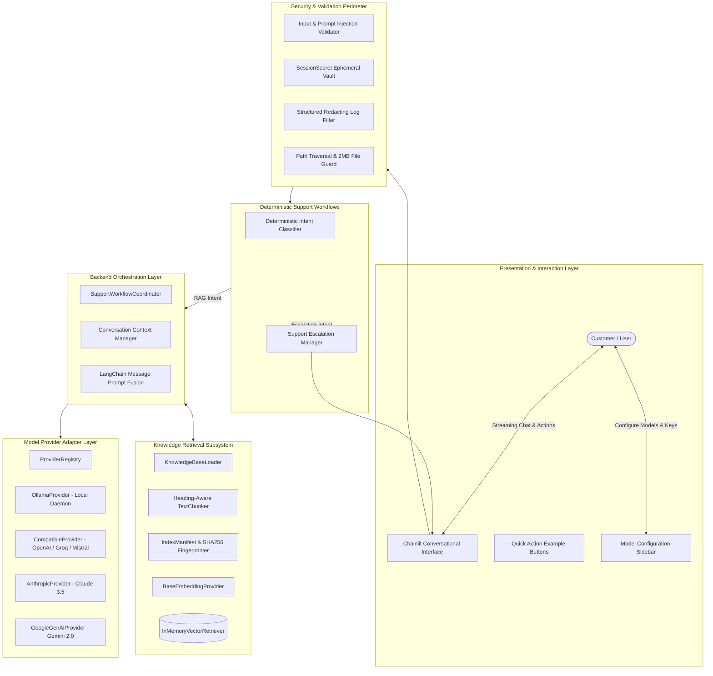

# System Architecture Documentation

## 1. Overview
The **AI Customer Support Chatbot** is built as a layered, modular application combining modern conversational UX, local and cloud language model execution, semantic knowledge base retrieval (RAG), and security boundaries.

The design adheres to the **Separation of Concerns (SoC)** principle, ensuring that UI components, orchestration logic, vector retrieval, and inference providers are decoupled and testable in isolation.

---

## 2. Architecture Layers



---

## 3. Component Responsibilities

### 3.1 Presentation Layer (`Chainlit` & `app.py`)
- Renders the responsive chat interface and real-time state indicators.
- Manages connection websockets and user session bindings.
- Exposes interactive quick action buttons for common FAQs (refunds, shipping, troubleshooting, escalation).
- Dispatches model configuration updates to server-side session state.
- Streams response tokens incrementally (`msg.stream_token`).
- Handles user input without storing credentials in browser storage or cookies.

### 3.2 Security & Validation Layer (`support_bot.security`)
- **Input Bounds:** Validates message lengths (default max 3,000 characters), rejects empty or whitespace-only inputs.
- **Prompt Injection Defense:** Scans queries for adversarial overrides (e.g. system prompt extraction, jailbreak patterns).
- **Ephemeral Credentials:** Encapsulates API keys in `SessionSecret`, ensuring zero serialization to disk, database, or logs.
- **Scrubbed Logging:** Automatically redacts API keys, Bearer tokens, and secrets from all logger streams using `RedactingFilter`.
- **Path Traversal Defense:** Verifies that loaded FAQ documents reside strictly within approved `knowledge_base` subdirectories.

### 3.3 Workflow & Support Intent Layer (`support_bot.workflows`)
- **Intent Classifier (`IntentClassifier`):** Uses deterministic regex patterns and keyword signatures to classify queries into 8 categories:
  - `HUMAN_ESCALATION`
  - `ACCOUNT_ACCESS`
  - `ORDER_SHIPPING`
  - `REFUND_CANCELLATION`
  - `TROUBLESHOOTING`
  - `FAQ_INFORMATIONAL`
  - `UNCLEAR_AMBIGUOUS`
  - `GENERAL_CHAT`
- **Escalation Manager (`SupportEscalationManager`):** Generates structured escalation briefing cards with recent user/assistant turns and clear expectations. Avoids making false claims regarding automated ticket creation.

### 3.4 Core Orchestration Layer (`support_bot.core`, `support_bot.conversation`, `support_bot.workflows`)
- **Settings Management:** Validates environment settings via Pydantic `BaseSettings`.
- **Conversation State:** Tracks multi-turn conversational history isolated by session ID in `ConversationContext`. Enforces maximum turn bounds to prevent context bloat.
- **Workflow Coordination:** Coordinates validation, intent routing, retrieval, prompt assembly, and streaming model execution in `SupportWorkflowCoordinator`.

### 3.5 Retrieval Subsystem (`support_bot.retrieval`)
- **Document Loader (`KnowledgeBaseLoader`):** Discovers `.md` and `.txt` files in `knowledge_base/faqs`, enforcing 2MB file size caps.
- **Semantic Chunker (`TextChunker`):** Employs heading-aware splitting, preserving `##` and `###` question-answer section integrity.
- **Index Manifest (`IndexManifest`):** Computes SHA256 file hashes to detect modifications and track index states (`NOT_INITIALIZED`, `READY`, `REBUILD_REQUIRED`, `ERROR`).
- **Embedding Provider:** Converts chunks into numerical vectors. Uses local Ollama embedding models (`nomic-embed-text`) or deterministic offline fallbacks.
- **Vector Store (`InMemoryVectorRetriever`):** In-memory vector store performing cosine-similarity search with minimum score thresholding (`min_score=0.20`) to eliminate irrelevant noise. Supports atomic rebuilds.

### 3.6 Provider Adapter Layer (`support_bot.providers`)
- **Provider Registry:** Central catalog of registered adapters (`ollama`, `openai`, `google`, `anthropic`, `groq`, `mistral`, `openai_compatible`).
- **OllamaProvider:** Connects to local Ollama instances via `http://localhost:11434` for 100% private zero-cost inference with live model discovery.
- **AnthropicProvider:** Connects to Anthropic API via `langchain-anthropic` (`ChatAnthropic`).
- **GoogleGenAIProvider:** Connects to Google Gemini via `langchain-google-genai` (`ChatGoogleGenerativeAI`).
- **OpenAICompatibleProvider:** Connects to OpenAI, Groq, Mistral, and generic gateways via `langchain-openai` (`ChatOpenAI`).

---

## 4. End-to-End Request & Streaming Lifecycle

1. **User Message:** Customer submits a question in the UI.
2. **Security Screening:** `validate_user_message` checks length and scans for prompt-injection attacks.
3. **Intent Classification:** `IntentClassifier` determines the intent category and whether retrieval is needed.
4. **Escalation Check:** If `HUMAN_ESCALATION`, an escalation briefing card is generated and returned immediately without making fake ticket claims.
5. **Session Context:** The user turn is logged into the session-isolated `ConversationManager`.
6. **Knowledge Base Retrieval:** If retrieval is required, `InMemoryVectorRetriever` searches indexed FAQ chunks, filtering out low-similarity matches below `min_score=0.20`.
7. **Prompt Fusion:** The grounded system prompt, retrieved FAQ context, prior conversation turns, and current question are fused into LangChain `BaseMessage` objects.
8. **Real-Time Token Streaming:**
   - The provider client executes `astream(messages)`.
   - Each token chunk is emitted via async generator and displayed on the UI in real time via `msg.stream_token`.
9. **Citation Pairing:** Genuine source references (document title, section, and excerpt) are extracted and attached below the assistant response.
10. **State Recording:** The assistant response and citations are saved to the session conversation history.

---

## 5. Multi-User Session Isolation Architecture

```
User Session A (Session ID: session_alpha)
├── ConversationContext [Turns 1..N]
├── SessionSecret [Alice's Cloud API Key]
└── Isolated SupportWorkflowCoordinator

User Session B (Session ID: session_beta)
├── ConversationContext [Empty / Bob's Turns]
├── SessionSecret [Unconfigured / Bob's Key]
└── Isolated SupportWorkflowCoordinator
```

- Each user session runs with its own instance of `ConversationManager` and `SessionSecret`.
- No global dictionaries store customer chat turns.
- API keys entered in one browser session cannot be accessed or used by any other session.
- Tested and verified in `tests/unit/test_session_isolation.py`.
