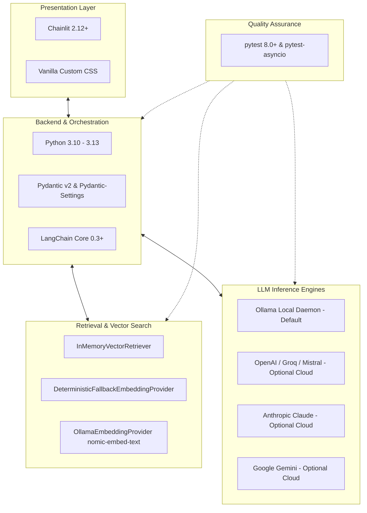

# Technology Stack Reference: AI Customer Support Chatbot
**Repository:** `ai-support-chatbot`  
**Purpose:** Technical explanation of every core framework, orchestration layer, and provider integration used in this application.  

---

## 1. Architectural Stack Overview

---

## 2. Component-by-Component Technology Reference

### 2.1 Python 3.10 - 3.13
- **What it is:** High-level, type-annotated programming language with native asynchronous I/O (`asyncio`).
- **Why this project uses it:** Provides native asynchronous event loops for real-time WebSocket communication, streaming generators, type hints for architectural safety, and access to the modern AI ecosystem.
- **Which component depends on it:** All application modules (`src/support_bot/`, `app.py`, `tests/`).
- **What happens if unavailable:** The application cannot run.
- **Requirement Status:** **Mandatory (Core Runtime)**.

---

### 2.2 Chainlit (v2.12+)
- **What it is:** An open-source, asynchronous conversational UI framework tailored for LLM applications.
- **Why this project uses it:** Delivers an out-of-the-box, accessible chat interface with native token-by-token streaming, interactive suggestion chips, custom sidebar settings, file serving, and WebSocket session isolation.
- **Which component depends on it:** `app.py`, `.chainlit/config.toml`, `public/custom.css`.
- **What happens if unavailable:** The web chat interface cannot start or accept user requests.
- **Requirement Status:** **Mandatory (UI Layer)**.

---

### 2.3 LangChain (v0.3+)
- **What it is:** An orchestration framework standardizing message data structures (`SystemMessage`, `HumanMessage`, `AIMessage`, `AIMessageChunk`), chat model abstractions, and prompt templates.
- **Why this project uses it:** Decouples prompt fusion and conversation state from specific provider SDKs. Allows seamless switching between local Ollama and cloud providers without changing business logic.
- **Which component depends on it:** `src/support_bot/workflows/support_workflow.py`, `src/support_bot/providers/`.
- **What happens if unavailable:** Message serialization and provider adapter calls fail.
- **Requirement Status:** **Mandatory (Orchestration Layer)**.

---

### 2.4 Ollama (Local LLM Daemon)
- **What it is:** A lightweight local model runner that serves open-weight models (such as Llama 3.2, Mistral, Qwen) via a local REST API (`http://localhost:11434`).
- **Why this project uses it:** Serves as the **default zero-cost inference engine**, providing 100% private AI execution where no customer queries or data ever leave the local machine.
- **Which component depends on it:** `src/support_bot/providers/ollama_provider.py`.
- **What happens if unavailable:** The UI displays a warning banner (`🟡 Local Ollama Not Running`) with setup instructions (`ollama serve`), and offers switching to an optional cloud provider.
- **Requirement Status:** **Default Engine (Locally Recommended, Zero-Cost)**.

---

### 2.5 In-Memory Vector Retriever & Heading-Aware Chunker
- **What it is:** Custom vector search implementation computing cosine similarity over document chunks, paired with a heading-aware Markdown splitter.
- **Why this project uses it:**
  - Preserves FAQ question-and-answer pairs by splitting on `##` and `###` headers.
  - Eliminates the need for heavy external vector databases (e.g. Chroma, Pinecone) for local FAQ knowledge bases.
  - Provides atomic re-indexing and safe rollback on error.
- **Which component depends on it:** `src/support_bot/retrieval/retriever.py`, `chunking.py`, `loader.py`.
- **What happens if unavailable:** Grounded retrieval fails; the system operates in general conversational mode without FAQ source citations.
- **Requirement Status:** **Mandatory (RAG Subsystem)**.

---

### 2.6 Deterministic Fallback Embedding Provider
- **What it is:** A normalized, hash-based vector generator using regex tokenization, stop-word down-weighting, and MD5 feature hashing.
- **Why this project uses it:** Enables immediate local verification, unit tests, and offline operation without downloading gigabytes of neural model weights or making external network calls.
- **Which component depends on it:** `src/support_bot/retrieval/embeddings.py`, `retriever.py`.
- **What happens if unavailable:** Falls back to unindexed retrieval or requires a running Ollama embedding model (`nomic-embed-text`).
- **Requirement Status:** **Default Fallback (Zero-Dependency)**.

---

### 2.7 Pydantic (v2.7+) & Pydantic-Settings
- **What it is:** High-performance data validation library powered by a Rust core (`pydantic-core`).
- **Why this project uses it:** Validates environment variables, enforces generation hyperparameter boundaries (temperature $\in [0, 2]$, top-p $\in [0, 1]$), and ensures structured runtime session configs.
- **Which component depends on it:** `src/support_bot/core/config.py`, `retrieval/chunking.py`, `retriever.py`.
- **What happens if unavailable:** Configuration loading and data modeling throw ImportErrors.
- **Requirement Status:** **Mandatory (Validation & Settings)**.

---

### 2.8 Optional Cloud Provider Adapters (OpenAI, Groq, Mistral, Anthropic, Google)
- **What they are:** Modular provider adapters implementing `BaseModelProvider`:
  - `OpenAICompatibleProvider`: Connects to OpenAI (`gpt-4o-mini`), Groq (`llama-3.3-70b-versatile`), Mistral (`mistral-small`), and custom endpoints.
  - `AnthropicProvider`: Connects to Anthropic Claude (`claude-3-5-sonnet`, `claude-3-5-haiku`).
  - `GoogleGeminiProvider`: Connects to Google Gemini (`gemini-2.0-flash`, `gemini-1.5-flash`).
- **Why this project uses it:** Demonstrates enterprise multi-provider flexibility with session-scoped, ephemeral credential handling.
- **Which component depends on it:** `src/support_bot/providers/`.
- **What happens if unavailable / unconfigured:** The user continues using the default local Ollama engine.
- **Requirement Status:** **Optional (Cloud Extensions)**.

---

### 2.9 pytest & pytest-asyncio
- **What it is:** Python testing framework with native support for asynchronous test fixtures and coroutines.
- **Why this project uses it:** Automates execution of 57+ unit and integration tests covering chunking, secret redaction, session isolation, intent classification, and end-to-end support scenarios.
- **Which component depends on it:** `tests/`.
- **What happens if unavailable:** Development-time test verification cannot run; runtime is unaffected.
- **Requirement Status:** **Developer Dependency (QA & CI/CD)**.
